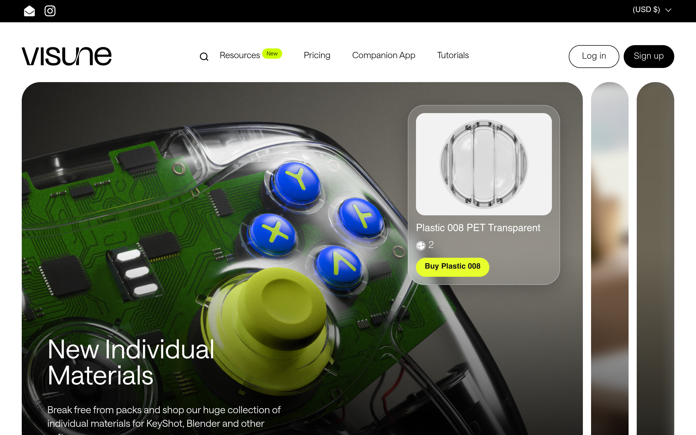

# visune Design System

You are building UI for **visune**. Light-themed, warm palette, sans-serif typography (Saans-Heavy), compact density on a 4px grid, expressive motion.

## Visual Reference

**IMPORTANT**: Study ALL screenshots below before writing any UI. Match colors, typography, spacing, layout, and motion exactly as shown.

### Homepage



### Scroll Journey (Cinematic Visual States)

> These screenshots capture the website at different scroll depths. The design changes dramatically as you scroll — each frame shows a different cinematic state. Replicate these exact visual transitions.

#### 0% — Hero / Above the fold


#### 17% — Mid-page at 17% scroll


#### 33% — Mid-page at 33% scroll


#### 50% — Mid-page at 50% scroll


#### 67% — Mid-page at 67% scroll


#### 83% — Mid-page at 83% scroll


#### 100% — Footer / End of page


> Read `references/DESIGN.md` for full token details. Read `references/ANIMATIONS.md` for motion specs. Read `references/LAYOUT.md` for layout structure. Read `references/COMPONENTS.md` for component patterns.

## Ultra Reference Files

This package includes extended documentation. **Read these files before implementing:**

| File | Contents |
|------|----------|
| `references/DESIGN.md` | Full design system tokens, colors, typography, spacing |
| `references/VISUAL_GUIDE.md` | **START HERE** — Master visual guide with all screenshots embedded |
| `references/ANIMATIONS.md` | CSS keyframes, scroll triggers, motion library stack, video specs |
| `references/LAYOUT.md` | Flex/grid containers, page structure, spacing relationships |
| `references/COMPONENTS.md` | DOM component patterns, HTML structure, class fingerprints |
| `references/INTERACTIONS.md` | Hover/focus states with before/after style diffs |
| `screens/scroll/` | 7 scroll journey screenshots showing cinematic states |

### Animation Stack Detected

- **Web Animations API (2 active)** — animation

## Design Philosophy

- **Layered depth** — use shadow tokens to create a sense of physical layering. Each elevation level has a specific shadow.
- **Gradient accents** — gradients are used thoughtfully for emphasis, not decoration.
- **Type pairing** — Saans-Heavy for body/UI text, Saans-Bold for headings/display. Never introduce a third typeface.
- **compact density** — 4px base grid. Every dimension is a multiple of 4.
- **warm palette** — the color temperature runs warm, matching the sans-serif typography.
- **Restrained accent** — `#ccff00` is the only pop of color. Used exclusively for CTAs, links, focus rings, and active states.
- **Expressive motion** — animations are an integral part of the experience. Use spring physics and layout animations.

## Color System

### Core Palette

| Role | Token | Hex | Use |
|------|-------|-----|-----|
| Background | `--background` | `#ffffff` | Page/app background |
| Surface | `--surface` | `#f5f5f5` | Cards, panels, modals |
| Text Primary | `--text-primary` | `#000000` | Headings, body text |
| Text Muted | `--text-muted` | `#5e5e5e` | Captions, placeholders |
| Accent | `--accent` | `#ccff00` | CTAs, links, focus rings |
| Border | `--border` | `#282830` | Dividers, card borders |

### Status Colors

| Status | Hex | Use |
|--------|-----|-----|
| Success | `#51ce0f` | Confirmations, positive trends |
| Danger | `#e56d6d` | Errors, destructive actions |

### Extended Palette

- **color-background-footer:** `#151515` — Deep background layer or shadow color
- **color-background-cards:** `#e7e5e2` — Light surface or highlight color
- `#d3d3d3`
- `#acacac`
- `#1d2020` — Deep background layer or shadow color
- `#9e9a8f`
- `#919191`
- `#767676`

### CSS Variable Tokens

```css
--color-background-cards: var(--color-background-main);
--color-text-cards: var(--color-text-main);
--color-foreground-cards: var(--color-foreground-main);
--color-secondary-text-cards: var(--color-secondary-text-main);
--color-accent-cards: var(--color-text-main);
--color-foreground-accent-cards: var(--color-foreground-main);
--color-borders-cards: var(--color-borders-main);
--font-weight-headings-primary: 400;
--font-style-headings-primary: normal;
--font-weight-body-primary: 400;
--font-weight-body-primary-bold: 700;
--font-weight-body-primary-medium: 400;
--font-style-body-primary: normal;
--font-weight-body-secondary: 400;
--font-weight-body-secondary-bold: 700;
--font-style-body-secondary: normal;
--base-headings-primary-size: 60;
--base-headings-secondary-size: ;
--base-body-primary-size: 16;
--base-body-secondary-size: 18;
```

## Typography

### Font Stack

- **Saans-Heavy** — Heading 1, Heading 2, Heading 3
- **Saans-Bold** — Body, Caption

### Font Sources

```css
@font-face {
  font-family: "Saans-Bold";
  src: url("fonts/Saans-Bold-Regular.woff2") format("woff2");
  font-weight: 400;
}
@font-face {
  font-family: "Saans-Heavy";
  src: url("fonts/Saans-Heavy-Regular.woff2") format("woff2");
  font-weight: 400;
}
@font-face {
  font-family: "Saans-Light";
  src: url("fonts/Saans-Light-Regular.woff2") format("woff2");
  font-weight: 400;
}
@font-face {
  font-family: "Saans-Medium";
  src: url("fonts/Saans-Medium-Regular.woff2") format("woff2");
  font-weight: 400;
}
@font-face {
  font-family: "Saans-Regular";
  src: url("fonts/Saans-Regular-Regular.woff2") format("woff2");
  font-weight: 400;
}
@font-face {
  font-family: "Saans-SemiBold";
  src: url("fonts/Saans-SemiBold-Regular.woff2") format("woff2");
  font-weight: 400;
}
```

### Type Scale

| Role | Family | Size | Weight |
|------|--------|------|--------|
| Heading 1 | Saans-Heavy | calc(120px/60*var(--base-headings-primary-size) + 0px) | 700 |
| Heading 2 | Saans-Heavy | 90px | 700 |
| Heading 3 | Saans-Heavy | calc(80px/60*var(--base-headings-primary-size) + 0px) | 700 |
| Body | Saans-Bold | calc(16px/16*var(--base-body-primary-size) + 0px) | 400 |
| Caption | Saans-Bold | 14px | 400 |

### Typography Rules

- Body/UI: **Saans-Heavy**, Headings: **Saans-Bold** — these are the only display fonts
- Max 3-4 font sizes per screen
- Headings: weight 600-700, body: weight 400
- Use color and opacity for text hierarchy, not additional font sizes
- Line height: 1.5 for body, 1.2 for headings

## Spacing & Layout

### Base Grid: 4px

Every dimension (margin, padding, gap, width, height) must be a multiple of **4px**.

### Spacing Scale

`2, 4, 6, 8, 10, 12, 14, 16, 18, 20, 22, 24` px

### Spacing as Meaning

| Spacing | Use |
|---------|-----|
| 4-8px | Tight: related items (icon + label, avatar + name) |
| 12-16px | Medium: between groups within a section |
| 24-32px | Wide: between distinct sections |
| 48px+ | Vast: major page section breaks |

### Border Radius

Scale: `.3125rem, .375rem, .5rem, .625rem, 1.25rem, 2em, 2rem, 3px, 4px, 5px, 6px, 8px, 10px, 12px, 15px, 16px, 17px, 20px, 24px, 28px, 30px, 32px, 34px, 40px, 45px, 60px, 100%, 999px, inherit, 100px`
Default: `16px`

### Container

Max-width: `1023px`, centered with auto margins.

### Breakpoints

| Name | Value |
|------|-------|
| xs | 350px |
| xs | 374px |
| xs | 400px |
| xs | 460px |
| xs | 470px |
| xs | 474px |
| xs | 475px |
| sm | 510px |
| sm | 511px |
| sm | 550px |
| sm | 600px |
| sm | 620px |
| sm | 640px |
| md | 680px |
| md | 700px |
| md | 749px |
| md | 767px |
| md | 768px |
| lg | 840px |
| lg | 880px |
| lg | 900px |
| lg | 989px |
| lg | 990px |
| lg | 1000px |
| lg | 1023px |
| lg | 1024px |
| xl | 1200px |
| xl | 1280px |
| 2xl | 1281px |
| 2xl | 1300px |
| 2xl | 1310px |
| 2xl | 1360px |
| 2xl | 1361px |
| 2xl | 1366px |
| 2xl | 1400px |
| 2xl | 1920px |

Mobile-first: design for small screens, layer on responsive overrides.

## Component Patterns

### Card

```css
.card {
  background: #f5f5f5;
  border: 1px solid #282830;
  border-radius: 16px;
  padding: 16px;
  box-shadow: 0 0#0000;
}
```

```html
<div class="card">
  <h3>Card Title</h3>
  <p>Card content goes here.</p>
</div>
```

### Button

```css
/* Primary */
.btn-primary {
  background: #ccff00;
  color: #000000;
  border-radius: 16px;
  padding: 8px 16px;
  font-weight: 500;
  transition: opacity 150ms ease;
}
.btn-primary:hover { opacity: 0.9; }

/* Ghost */
.btn-ghost {
  background: transparent;
  border: 1px solid #282830;
  color: #000000;
  border-radius: 16px;
  padding: 8px 16px;
}
```

```html
<button class="btn-primary">Get Started</button>
<button class="btn-ghost">Learn More</button>
```

### Input

```css
.input {
  background: #ffffff;
  border: 1px solid #282830;
  border-radius: 16px;
  padding: 8px 12px;
  color: #000000;
  font-size: 14px;
}
.input:focus { border-color: #ccff00; outline: none; }
```

```html
<input class="input" type="text" placeholder="Search..." />
```

### Badge / Chip

```css
.badge {
  display: inline-flex;
  align-items: center;
  padding: 4px 8px;
  border-radius: 9999px;
  font-size: 12px;
  font-weight: 500;
  background: #f5f5f5;
  color: #5e5e5e;
}
```

```html
<span class="badge">New</span>
<span class="badge">Beta</span>
```

### Modal / Dialog

```css
.modal-backdrop { background: rgba(0, 0, 0, 0.6); }
.modal {
  background: #f5f5f5;
  border: 1px solid #282830;
  border-radius: 100px;
  padding: 24px;
  max-width: 480px;
  width: 90vw;
  box-shadow: 0 2px 10px 2px #0000000f;
}
```

```html
<div class="modal-backdrop">
  <div class="modal">
    <h2>Dialog Title</h2>
    <p>Dialog content.</p>
    <button class="btn-primary">Confirm</button>
    <button class="btn-ghost">Cancel</button>
  </div>
</div>
```

### Table

```css
.table { width: 100%; border-collapse: collapse; }
.table th {
  text-align: left;
  padding: 8px 12px;
  font-weight: 500;
  font-size: 12px;
  color: #5e5e5e;
  text-transform: uppercase;
  letter-spacing: 0.05em;
  border-bottom: 1px solid #282830;
}
.table td {
  padding: 12px;
  border-bottom: 1px solid #282830;
}
```

```html
<table class="table">
  <thead><tr><th>Name</th><th>Status</th><th>Date</th></tr></thead>
  <tbody>
    <tr><td>Item One</td><td>Active</td><td>Jan 1</td></tr>
    <tr><td>Item Two</td><td>Pending</td><td>Jan 2</td></tr>
  </tbody>
</table>
```

### Navigation

```css
.nav {
  display: flex;
  align-items: center;
  gap: 8px;
  padding: 12px 16px;
  border-bottom: 1px solid #282830;
}
.nav-link {
  color: #5e5e5e;
  padding: 8px 12px;
  border-radius: 16px;
  transition: color 150ms;
}
.nav-link:hover { color: #000000; }
.nav-link.active { color: #ccff00; }
```

```html
<nav class="nav">
  <a href="/" class="nav-link active">Home</a>
  <a href="/about" class="nav-link">About</a>
  <a href="/pricing" class="nav-link">Pricing</a>
  <button class="btn-primary" style="margin-left: auto">Get Started</button>
</nav>
```

### Extracted Components

These components were found in the codebase:

**Button** (`html`)
- Variants: `-prev`, `-next`

**Card** (`html`)
- Variants: `banner`, `s`, `banner__curtain`, `content`, `banner__body`

**Badge** (`html`)

**Modal** (`html`)

## Page Structure

The following page sections were detected:

- **Navigation** — Top navigation bar (48 items)
- **Hero** — Hero/banner section with headline and CTAs
- **Features** — Feature/benefit cards grid (56 items)
- **Faq** — FAQ/accordion section
- **Cta** — Call-to-action section

When building pages, follow this section order and structure.

## Animation & Motion

This project uses **expressive motion**. Animations are part of the design language.

### CSS Animations

- `shopify-rotator`
- `shopify-dash`
- `acceleratedCheckoutLoadingSkeleton`
- `dash`
- `dash-check`

### Motion Tokens

- **Duration scale:** `0ms`, `1s`, `5s`, `10ms`, `40ms`, `50ms`, `80ms`, `100ms`, `120ms`, `122ms`, `140ms`, `150ms`, `175ms`, `180ms`, `200ms`, `210ms`, `250ms`, `280ms`, `300ms`, `350ms`, `380ms`, `400ms`, `450ms`, `500ms`, `550ms`, `600ms`, `700ms`, `1000ms`
- **Easing functions:** `ease-in-out`, `linear`, `ease`, `ease-out`, `cubic-bezier(.47,1.64,.41,.8)`, `cubic-bezier(.4,0,.2,1)`, `cubic-bezier(0.4,0,0.2,1)`, `cubic-bezier(0.25,0.46,0.45,0.94)`
- **Animated properties:** `background`

### Motion Guidelines

- **Duration:** Use values from the duration scale above. Short (0ms) for micro-interactions, long (1000ms) for page transitions
- **Easing:** Use `ease-in-out` as the default easing curve
- **Direction:** Elements enter from bottom/right, exit to top/left
- **Reduced motion:** Always respect `prefers-reduced-motion` — disable animations when set

## Depth & Elevation

### Shadow Tokens

- Subtle: `0 0 0 1px var(--color-text-main)`
- Subtle: `inset 0 0 0 1px #0003`
- Raised (cards, buttons): `0 0#0000`
- Raised (cards, buttons): `0 0 1.875rem .375rem #00000026`
- Raised (cards, buttons): `0 0 0 3px var(--color-secondary-background-main)`
- Raised (cards, buttons): `0 0 0 .1875rem var(--color-secondary-background-main)`

### Z-Index Scale

`0, 1, 2, 3, 4, 6, 7, 8, 9, 10, 11, 20, 99, 100, 200, 999, 1000, 1001, 1002, 9999, 10000, 10001, 10002, 10003, 99999, 1000000`

Use these exact values — never invent z-index values.

## Anti-Patterns (Never Do)

- **No blur effects** — no backdrop-blur, no filter: blur()
- **No zebra striping** — tables and lists use borders for separation
- **No invented colors** — every hex value must come from the palette above
- **No arbitrary spacing** — every dimension is a multiple of 4px
- **No extra fonts** — only Saans-Heavy and Saans-Bold are allowed
- **No arbitrary border-radius** — use the scale: .3125rem, .375rem, .5rem, .625rem, 1.25rem, 2em, 2rem, 3px, 4px, 5px
- **No opacity for disabled states** — use muted colors instead

## Workflow

1. **Read** `references/DESIGN.md` before writing any UI code
2. **Pick colors** from the Color System section — never invent new ones
3. **Set typography** — Saans-Heavy, Saans-Bold only, using the type scale
4. **Build layout** on the 4px grid — check every margin, padding, gap
5. **Match components** to patterns above before creating new ones
6. **Apply elevation** — use shadow tokens
7. **Validate** — every value traces back to a design token. No magic numbers.

## Brand Spec

- **Favicon:** `//visune.io/cdn/shop/files/Visune_Favicon_df081cff-a8f8-4098-825a-107897f5cf0f.png`
- **Site URL:** `https://visune.io/`
- **Brand color:** `#ccff00`
- **Brand typeface:** Saans-Heavy

## Quick Reference

```
Background:     #ffffff
Surface:        #f5f5f5
Text:           #000000 / #5e5e5e
Accent:         #ccff00
Border:         #282830
Font:           Saans-Heavy
Spacing:        4px grid
Radius:         16px
Components:     9 detected
```

## When to Trigger

Activate this skill when:
- Creating new components, pages, or visual elements for visune
- Writing CSS, Tailwind classes, styled-components, or inline styles
- Building page layouts, templates, or responsive designs
- Reviewing UI code for design consistency
- The user mentions "visune" design, style, UI, or theme
- Generating mockups, wireframes, or visual prototypes

---

# Full Reference Files

> Every output file is embedded below. Claude has full design system context from /skills alone.

## Design System Tokens (DESIGN.md)

# visune DESIGN.md

> Auto-generated design system — reverse-engineered via static analysis by skillui.
> Frameworks: None detected
> Colors: 20 · Fonts: 2 · Components: 9
> Icon library: not detected · State: not detected
> Primary theme: light · Dark mode toggle: no · Motion: expressive

## Visual Reference

**Match this design exactly** — study colors, fonts, spacing, and component shapes before writing any UI code.


---

## 1. Visual Theme & Atmosphere

This is a **light-themed** interface with a warm, approachable feel. The light background emphasizes content clarity. Typography pairs **Saans-Bold** for display/headings with **Saans-Heavy** for body text, creating clear visual hierarchy through type contrast. Spacing follows a **4px base grid** (compact density), with scale: 2, 4, 6, 8, 10, 12, 14, 16px. The accent color **#ccff00** anchors interactive elements (buttons, links, focus rings). Motion is expressive — spring physics, layout animations, and staggered reveals are part of the visual language.

---

## 2. Color Palette & Roles

| Token | Hex | Role | Use |
|---|---|---|---|
| color-background-header | `#ffffff` | background | Page background, darkest surface |
| color-background-main-alternate | `#f5f5f5` | surface | Card and panel backgrounds |
| color-text-header | `#000000` | text-primary | Headings and body text |
| text-muted | `#5e5e5e` | text-muted | Captions, placeholders, secondary info |
| color-text-cards | `#282830` | border | Dividers, card borders, outlines |
| accent | `#ccff00` | accent | CTAs, links, focus rings, active states |
| danger | `#e56d6d` | danger | Error states, destructive actions |
| success | `#51ce0f` | success | Success states, positive indicators |
| info | `#020024` | info | Informational highlights |
| color-background-footer | `#151515` | unknown | Palette color |
| color-background-cards | `#e7e5e2` | unknown | Palette color |
| unknown | `#d3d3d3` | unknown | Palette color |
| unknown | `#acacac` | unknown | Palette color |
| unknown | `#1d2020` | unknown | Palette color |
| unknown | `#9e9a8f` | unknown | Palette color |
| unknown | `#919191` | unknown | Palette color |
| unknown | `#767676` | unknown | Palette color |
| unknown | `#3b393d` | unknown | Palette color |
| unknown | `#52c057` | unknown | Palette color |
| unknown | `#de1e1e` | unknown | Palette color |

### CSS Variable Tokens

```css
--color-background-cards: var(--color-background-main);
--color-text-cards: var(--color-text-main);
--color-foreground-cards: var(--color-foreground-main);
--color-secondary-text-cards: var(--color-secondary-text-main);
--color-accent-cards: var(--color-text-main);
--color-foreground-accent-cards: var(--color-foreground-main);
--color-borders-cards: var(--color-borders-main);
--font-weight-headings-primary: 400;
--font-style-headings-primary: normal;
--font-weight-body-primary: 400;
--font-weight-body-primary-bold: 700;
--font-weight-body-primary-medium: 400;
--font-style-body-primary: normal;
--font-weight-body-secondary: 400;
--font-weight-body-secondary-bold: 700;
--font-style-body-secondary: normal;
--base-headings-primary-size: 60;
--base-headings-secondary-size: ;
--base-body-primary-size: 16;
--base-body-secondary-size: 18;
```


---

## 3. Typography Rules

**Font Stack:**
- **Saans-Heavy** — Heading 1, Heading 2, Heading 3
- **Saans-Bold** — Body, Caption

**Font Sources:**

```css
@font-face {
  font-family: "Saans-Bold";
  src: url("fonts/Saans-Bold-Regular.woff2") format("woff2");
  font-weight: 400;
}
@font-face {
  font-family: "Saans-Heavy";
  src: url("fonts/Saans-Heavy-Regular.woff2") format("woff2");
  font-weight: 400;
}
@font-face {
  font-family: "Saans-Light";
  src: url("fonts/Saans-Light-Regular.woff2") format("woff2");
  font-weight: 400;
}
@font-face {
  font-family: "Saans-Medium";
  src: url("fonts/Saans-Medium-Regular.woff2") format("woff2");
  font-weight: 400;
}
@font-face {
  font-family: "Saans-Regular";
  src: url("fonts/Saans-Regular-Regular.woff2") format("woff2");
  font-weight: 400;
}
@font-face {
  font-family: "Saans-SemiBold";
  src: url("fonts/Saans-SemiBold-Regular.woff2") format("woff2");
  font-weight: 400;
}
```

| Role | Font | Size | Weight |
|---|---|---|---|
| Heading 1 | Saans-Heavy | calc(120px/60*var(--base-headings-primary-size) + 0px) | 700 |
| Heading 2 | Saans-Heavy | 90px | 700 |
| Heading 3 | Saans-Heavy | calc(80px/60*var(--base-headings-primary-size) + 0px) | 700 |
| Body | Saans-Bold | calc(16px/16*var(--base-body-primary-size) + 0px) | 400 |
| Caption | Saans-Bold | 14px | 400 |

**Typographic Rules:**
- Limit to 2 font families max per screen
- Use **Saans-Heavy** for body/UI text, **Saans-Bold** for display/headings
- Maintain consistent hierarchy: no more than 3-4 font sizes per screen
- Headings use bold (600-700), body uses regular (400)
- Line height: 1.5 for body text, 1.2 for headings
- Use color and opacity for secondary hierarchy, not additional font sizes


---

## 4. Component Stylings

### Navigation (1)

**Navigation** — `html`

### Data Display (3)

**Card** — `html`
- Variants: `banner`, `s`, `banner__curtain`, `content`, `banner__body`

**Badge** — `html`

**List** — `html`

### Data Input (2)

**Button** — `html`
- Variants: `-prev`, `-next`
- Animation: 

**Input** — `html`
- State: :focus, :placeholder

### Overlay (1)

**Modal** — `html`

### Media (2)

**Image** — `html`

**Icon** — `html`


---

## 5. Layout Principles

- **Base spacing unit:** 4px
- **Spacing scale:** 2, 4, 6, 8, 10, 12, 14, 16, 18, 20, 22, 24
- **Border radius:** .3125rem, .375rem, .5rem, .625rem, 1.25rem, 2em, 2rem, 3px, 4px, 5px, 6px, 8px, 10px, 12px, 15px, 16px, 17px, 20px, 24px, 28px, 30px, 32px, 34px, 40px, 45px, 60px, 100%, 999px, inherit, 100px
- **Max content width:** 1023px

**Spacing as Meaning:**
| Spacing | Use |
|---|---|
| 4-8px | Tight: related items within a group |
| 12-16px | Medium: between groups |
| 24-32px | Wide: between sections |
| 48px+ | Vast: major section breaks |


---

## 6. Depth & Elevation

### Flat — subtle depth hints

- `0 0 0 1px var(--color-text-main)`
- `inset 0 0 0 1px #0003`

### Raised — cards, buttons, interactive elements

- `0 0#0000`
- `0 0 1.875rem .375rem #00000026`
- `0 0 0 3px var(--color-secondary-background-main)`

### Floating — dropdowns, popovers, modals

- `0 2px 10px 2px #0000000f`
- `inset -20px 19px 16px #0009,inset 20px -19px 16px #0009`
- `inset -20px 19px 16px rgba(0,0,0,0.6),inset 20px -19px 16px rgba(0,0,0,0.6)`

### Overlay — full-screen overlays, top-level dialogs

- `0 0 60px #0000001a`
- `0 9.5px 61.98px 2.37px #00000040`
- `0 8px 32px #1f268712`

### Z-Index Scale

`0, 1, 2, 3, 4, 6, 7, 8, 9, 10, 11, 20, 99, 100, 200, 999, 1000, 1001, 1002, 9999, 10000, 10001, 10002, 10003, 99999, 1000000`


---

## 7. Animation & Motion

This project uses **expressive motion**. Animations are an integral part of the experience.

### CSS Animations

- `@keyframes shopify-rotator`
- `@keyframes shopify-dash`
- `@keyframes acceleratedCheckoutLoadingSkeleton`
- `@keyframes dash`
- `@keyframes dash-check`
- `@keyframes fill-progress`
- `@keyframes reveal-image`
- `@keyframes reveal-opacity`

### Animated Components

- **Button**: 

### Motion Guidelines

- Duration: 150-300ms for micro-interactions, 300-500ms for page transitions
- Easing: `ease-out` for enters, `ease-in` for exits
- Always respect `prefers-reduced-motion`


---

## 8. Do's and Don'ts

### Do's

- Use `#ccff00` for interactive elements (buttons, links, focus rings)
- Use `#ffffff` as the primary page background
- Pair **Saans-Heavy** (body) with **Saans-Bold** (display) — these are the only allowed fonts
- Follow the **4px** spacing grid for all margins, padding, and gaps
- Use the defined shadow tokens for elevation — see Section 6
- Use border-radius from the scale: .3125rem, .375rem, .5rem, .625rem, 1.25rem
- Reuse existing components from Section 4 before creating new ones

### Don'ts

- Don't introduce colors outside this palette — extend the design tokens first
- Don't introduce additional font families beyond Saans-Heavy and Saans-Bold
- Don't use arbitrary spacing values — stick to multiples of 4px
- Don't create custom box-shadow values outside the system tokens
- Don't use arbitrary border-radius values — pick from the defined scale
- Don't duplicate component patterns — check Section 4 first
- Don't use backdrop-blur or blur effects

### Anti-Patterns (detected from codebase)

- No blur or backdrop-blur effects
- No zebra striping on tables/lists


---

## 9. Responsive Behavior

| Name | Value | Source |
|---|---|---|
| xs | 350px | css |
| xs | 374px | css |
| xs | 400px | css |
| xs | 460px | css |
| xs | 470px | css |
| xs | 474px | css |
| xs | 475px | css |
| sm | 510px | css |
| sm | 511px | css |
| sm | 550px | css |
| sm | 600px | css |
| sm | 620px | css |
| sm | 640px | css |
| md | 680px | css |
| md | 700px | css |
| md | 749px | css |
| md | 767px | css |
| md | 768px | css |
| lg | 840px | css |
| lg | 880px | css |
| lg | 900px | css |
| lg | 989px | css |
| lg | 990px | css |
| lg | 1000px | css |
| lg | 1023px | css |
| lg | 1024px | css |
| xl | 1200px | css |
| xl | 1280px | css |
| 2xl | 1281px | css |
| 2xl | 1300px | css |
| 2xl | 1310px | css |
| 2xl | 1360px | css |
| 2xl | 1361px | css |
| 2xl | 1366px | css |
| 2xl | 1400px | css |
| 2xl | 1920px | css |

**Approach:** Use `@media (min-width: ...)` queries matching the breakpoints above.


---

## 10. Agent Prompt Guide

Use these as starting points when building new UI:

### Build a Card

```
Background: #f5f5f5
Border: 1px solid #282830
Radius: 16px
Padding: 16px
Font: Saans-Heavy
Use shadow tokens from Section 6.
```

### Build a Button

```
Primary: bg #ccff00, text white
Ghost: bg transparent, border #282830
Padding: 8px 16px
Radius: 16px
Hover: opacity 0.9 or lighter shade
Focus: ring with #ccff00
```

### Build a Page Layout

```
Background: #ffffff
Max-width: 1023px, centered
Grid: 4px base
Responsive: mobile-first, breakpoints from Section 9
```

### Build a Stats Card

```
Surface: #f5f5f5
Label: #5e5e5e (muted, 12px, uppercase)
Value: #000000 (primary, 24-32px, bold)
Status: use success/warning/danger from Section 2
```

### Build a Form

```
Input bg: #ffffff
Input border: 1px solid #282830
Focus: border-color #ccff00
Label: #5e5e5e 12px
Spacing: 16px between fields
Radius: 16px
```

### General Component

```
1. Read DESIGN.md Sections 2-6 for tokens
2. Colors: only from palette
3. Font: Saans-Heavy, type scale from Section 3
4. Spacing: 4px grid
5. Components: match patterns from Section 4
6. Elevation: shadow tokens
```

## Visual Guide — Screenshots (VISUAL_GUIDE.md)

# visune — Visual Guide

> Master visual reference. Study every screenshot carefully before implementing any UI.
> Match colors, layout, typography, spacing, and motion states exactly.

**Motion Stack:** **Web Animations API (2 active)**

## Scroll Journey

The page has cinematic scroll animations. Each screenshot below shows the exact visual state at that scroll depth.
**Replicate these transitions precisely** — the design changes dramatically as you scroll.

### Hero — Above the fold

*Scroll position: 0px of 13339px total*


### 17% scroll depth

*Scroll position: 2115px of 13339px total*


### 33% scroll depth

*Scroll position: 4105px of 13339px total*


### 50% scroll depth

*Scroll position: 6220px of 13339px total*


### 67% scroll depth

*Scroll position: 8334px of 13339px total*


### 83% scroll depth

*Scroll position: 10324px of 13339px total*


### Footer — End of page

*Scroll position: 12439px of 13339px total*


## Full Page Screenshots

### Visune

*URL: `https://visune.io/`*


### Premium KeyShot Assets – Visune

*URL: `https://visune.io/collections/all`*


### Premium KeyShot Scenes – Visune

*URL: `https://visune.io/collections/scenes`*


### Material Packs – Visune

*URL: `https://visune.io/collections/materials`*


### Models – Visune

*URL: `https://visune.io/collections/models`*


## Section Screenshots

Clipped sections showing individual components in context.

### Section 1 — `section`

*1440×834px*


### Section 1 — `main > div`

*1440×1200px*


### Section 1 — `main > div`

*1440×1200px*


### Section 1 — `main > div`

*1440×1200px*


### Section 1 — `main > div`

*1440×1200px*


## Animations & Motion (ANIMATIONS.md)

# Animation Reference

> Cinematic motion design extracted from live DOM. Follow these specs exactly to recreate the experience.

## Motion Technology Stack

| Library | Type | Notes |
|---------|------|-------|
| **Web Animations API (2 active)** | animation |  |

## Scroll Journey

The page is **13.339px** tall. Each frame below shows what the user sees at that scroll depth.

> **Use these screenshots to understand WHAT animates, WHEN it animates, and HOW it moves.**

### 0% — Top / Hero
Scroll position: 0px


### 17% — Opening Section
Scroll position: 2115px


### 33% — First Feature Section
Scroll position: 4105px


### 50% — Mid-Page
Scroll position: 6220px


### 67% — Lower Content
Scroll position: 8334px


### 83% — Near Footer
Scroll position: 10.324px


### 100% — Bottom / Footer
Scroll position: 12.439px


## Video Elements

| # | Role | Autoplay | Loop | Muted | Size | First Frame |
|---|------|----------|------|-------|------|-------------|
| 1 | background | ✓ | ✓ | ✓ | 1280×519 | — |
| 2 | content | ✓ | ✓ | ✓ | 405×304 | — |

- **Source:** `https://cdn.shopify.com/videos/c/o/v/7619dc33a6de4def9d40667fadb334a7.mp4`
- **Source:** `https://cdn.shopify.com/videos/c/o/v/7bbfbb01e391467d8f7b0bc33c46c34d.mp4`

## Scroll Animation Patterns

| Pattern | Library | Element Count | Duration | Delay | Easing |
|---------|---------|---------------|----------|-------|--------|
| parallax / sticky scroll | CSS | 4 | — | — | — |

### CSS Implementation

## CSS Keyframes (13 extracted)

### `@keyframes reveal-opacity`

Duration: `245ms` · Easing: `ease-out` · Delay: `35ms` · Iteration: `1` · Fill: `forwards`

Used by: `.product-item__image-figure--on-top`, `.info-tabs__panel.active .info-tabs__image`

```css
@keyframes reveal-opacity {
  0% {
    opacity: 0;
  }
  100% {
    opacity: 1;
  }
}
```

> Opacity fade

### `@keyframes circle-bounce`

Duration: `0.4s` · Easing: `linear` · Delay: `0s` · Iteration: `infinite` · Fill: `none`

Used by: `.alert--circle.alert--circle-loading::before`

```css
@keyframes circle-bounce {
  0% {
    border-top-width: 2px;
    border-right-width: 2px;
    border-bottom-width: 2px;
    border-left-width: 2px;
    opacity: 0.5;
  }
  100% {
    border-top-width: 4px;
    border-right-width: 4px;
    border-bottom-width: 4px;
    border-left-width: 4px;
    opacity: 0.25;
  }
}
```

> Opacity fade · Dimension expand/collapse

### `@keyframes rotate`

Duration: `3s` · Easing: `linear` · Delay: `0s` · Iteration: `infinite` · Fill: `none`

Used by: `.button--loader .button__preloader-element`

```css
@keyframes rotate {
  100% {
    transform: rotate(360deg);
  }
}
```

> Transform/motion animation

### `@keyframes dash`

Duration: `6s` · Easing: `linear` · Delay: `0s` · Iteration: `infinite` · Fill: `none`

Used by: `.button--loader .button__preloader-element circle`

```css
@keyframes dash {
  0% {
    stroke-dasharray: 1, 200;
    stroke-dashoffset: 0;
  }
  50% {
    stroke-dasharray: 89, 200;
    stroke-dashoffset: -35;
  }
  100% {
    stroke-dasharray: 89, 200;
    stroke-dashoffset: -124;
  }
}
```

> SVG stroke animation

### `@keyframes move`

Duration: `0.35s` · Easing: `ease-in-out` · Delay: `0s` · Iteration: `1` · Fill: `forwards`

Used by: `.no-touchevents .button--move:hover .button__text`

```css
@keyframes move {
  0% {
    transform: translateY(0px);
  }
  49% {
    transform: translateY(-200%);
  }
  50% {
    transform: translateY(-200%);
    visibility: hidden;
  }
  51% {
    transform: translateY(200%);
  }
  52% {
    transform: translateY(200%);
    visibility: visible;
  }
  100% {
    transform: translateY(0px);
  }
}
```

> Transform/motion animation

### `@keyframes lazy-loading`

Duration: `4s` · Easing: `linear` · Delay: `0s` · Iteration: `infinite` · Fill: `none`

Used by: `.lazy-image:not(.lazy-image--no-transition)::after`

```css
@keyframes lazy-loading {
  0% {
    height: 0px;
    top: 0px;
  }
  33% {
    height: 100%;
    top: 0px;
  }
  66% {
    top: 100%;
    height: 0px;
  }
  100% {
    top: 0px;
    height: 0px;
  }
}
```

> Dimension expand/collapse

### `@keyframes shopify-rotator`

Duration: `1.4s` · Easing: `linear` · Delay: `0s` · Iteration: `infinite` · Fill: `none`

Used by: `.shopify-payment-button__button .spinner`

```css
@keyframes shopify-rotator {
  0% {
    transform: rotate(0deg);
  }
  100% {
    transform: rotate(270deg);
  }
}
```

> Transform/motion animation

### `@keyframes shopify-dash`

Duration: `1.4s` · Easing: `ease-in-out` · Delay: `0s` · Iteration: `infinite` · Fill: `none`

Used by: `.shopify-payment-button__button .path`

```css
@keyframes shopify-dash {
  0% {
    stroke-dashoffset: 280px;
  }
  50% {
    stroke-dashoffset: 75px;
    transform: rotate(135deg);
  }
  100% {
    stroke-dashoffset: 280px;
    transform: rotate(450deg);
  }
}
```

> Transform/motion animation · SVG stroke animation

### `@keyframes ai-logo-scroll-aazbmwnfluhhwdtvomaigenblock87f61e14nbptc`

Duration: `30s` · Easing: `linear` · Delay: `0s` · Iteration: `infinite` · Fill: `none`

Used by: `.ai-logo-carousel-track-aazbmwnfluhhwdtvomaigenblock87f61e14nbptc`

```css
@keyframes ai-logo-scroll-aazbmwnfluhhwdtvomaigenblock87f61e14nbptc {
  0% {
    transform: translateX(0px);
  }
  100% {
    transform: translateX(-50%);
  }
}
```

> Transform/motion animation

### `@keyframes reveal-image`

```css
@keyframes reveal-image {
  0% {
    clip-path: polygon(0px 0px, 100% 0px, 100% 0px, 0px 0px);
    transform: translateY(-0.625rem);
  }
  100% {
    clip-path: polygon(0px 0px, 100% 0px, 100% 100%, 0px 100%);
    transform: translateY(0px);
  }
}
```

> Transform/motion animation · Clip-path reveal

### `@keyframes lazyanimation`

```css
@keyframes lazyanimation {
  0% {
    opacity: 0;
    transform: translateY(10px) scale(1.05);
  }
  50% {
    opacity: 1;
    transform: translateY(5px) scale(1.025);
  }
  100% {
    opacity: 1;
    transform: translateY(0px) scale(1);
  }
}
```

> Fade + motion enter animation

### `@keyframes acceleratedCheckoutLoadingSkeleton`

```css
@keyframes acceleratedCheckoutLoadingSkeleton {
  50% {
    opacity: var(--shopify-accelerated-checkout-skeleton-animation-opacity-start,1);
  }
  75% {
    opacity: var(--shopify-accelerated-checkout-skeleton-animation-opacity-end,.5);
  }
  100% {
    opacity: var(--shopify-accelerated-checkout-skeleton-animation-opacity-start,1);
  }
}
```

> Opacity fade

### `@keyframes animateBorder`

```css
@keyframes animateBorder {
  0% {
    width: 0px;
  }
  100% {
    width: 100%;
  }
}
```

> Dimension expand/collapse

## Global Transition Declarations

These `transition` values were extracted from CSS rules across the site:

```css
transition: 175ms linear;
transition: opacity 0.12s linear;
transition: 0.1s linear;
transition: transform 175ms, 175ms linear;
transition: opacity 175ms linear, transform 175ms;
transition: background-color 175ms, border 175ms;
transition: transform 175ms linear;
transition: opacity 175ms linear;
transition: opacity 175ms;
transition: 175ms ease-out 50ms;
transition: width 0.5s cubic-bezier(0.47, 1.64, 0.41, 0.8);
transition: transform 175ms;
```

## How to Recreate This Motion Design

### Step 1 — Install Dependencies

```bash
```

### Step 2 — Scroll-Reveal Pattern

Elements that animate into view follow this pattern:

```css
/* Initial hidden state */
.reveal {
  opacity: 0;
  transform: translateY(40px);
  transition: opacity 175ms cubic-bezier(0.4, 0, 0.2, 1),
              transform 175ms cubic-bezier(0.4, 0, 0.2, 1);
}
.reveal.visible {
  opacity: 1;
  transform: translateY(0);
}
```

### Step 3 — Key Motion Principles

- **Video backgrounds** — use `<video autoplay loop muted playsinline>` for background videos. Always include a poster image fallback
- **Duration scale:** `175ms` · `0.12s` · `0.1s` — use these values, never invent new durations
- **Always add** `@media (prefers-reduced-motion: reduce) { * { animation-duration: 0.01ms !important; transition-duration: 0.01ms !important; } }`

### Step 4 — Scroll Journey Reference

Match what happens at each scroll position:

- **0%** (`0px`) → `screens/scroll/scroll-000.png`
- **17%** (`2115px`) → `screens/scroll/scroll-017.png`
- **33%** (`4105px`) → `screens/scroll/scroll-033.png`
- **50%** (`6220px`) → `screens/scroll/scroll-050.png`
- **67%** (`8334px`) → `screens/scroll/scroll-067.png`
- **83%** (`10324px`) → `screens/scroll/scroll-083.png`
- **100%** (`12439px`) → `screens/scroll/scroll-100.png`

## Layout & Grid (LAYOUT.md)

# Layout Reference

> Auto-extracted from live DOM. Use this to understand how the site is structured spatially.

## Spacing System

**Base grid:** 4px

**Scale:** `2, 4, 6, 8, 10, 12, 14, 16, 18, 20, 22, 24, 26, 28, 30` px

| Spacing | Semantic Use |
|---------|-------------|
| 4px | Tight — within a component |
| 8px | Medium — between sibling items |
| 16px | Wide — between sections |
| 32px | Vast — major section breaks |

## Flex Layouts

| Element | Direction | Justify | Align | Gap | Children |
|---------|-----------|---------|-------|-----|----------|
| `div.header__bottom.header-container` | row | space-between | center | — | 3 |
| `div.container--large.gutter-top--regular` | row | space-between | — | — | 2 |
| `div.section-heading.section-heading--left` | row | space-between | end | normal 30px | 1 |
| `div.section-heading.section-heading--left` | row | space-between | end | — | 1 |
| `div.reviewer-cards__row` | row | center | — | 20px | 3 |
| `div.section-heading.section-heading--left` | row | space-between | end | — | 1 |
| `div.section-heading.section-heading--left` | row | space-between | end | normal 30px | 2 |
| `div.section-heading.section-heading--left` | row | space-between | end | — | 1 |
| `div.animated-card-banner__cards` | row | — | stretch | 15px | 3 |
| `div#element-template--27397372182914__rich_text_YhyPNq.card.` | row | — | — | — | 1 |

## Grid Layouts

| Element | Template Columns | Gap | Children |
|---------|-----------------|-----|----------|
| `div.grid.grid--layout` | `383.984px 383.984px 383.984px` | 64px | 3 |
| `div#header-top.header__top.container--large` | `164.531px 891.469px 200px` | 12px | 5 |
| `div.grid.grid--layout` | `296px 296px 296px 296px` | 32px | 4 |
| `div.grid.grid--layout` | `405.328px 405.328px 405.328px` | 32px | 12 |

## Structural Containers

### `<main>` (`main#main.main-content`)

```
display:          block
children:         15
```

### `<section>` (`section#shopify-section-template--27397372182914__animated_c`)

```
display:          block
children:         1
```

### `<section>` (`section#shopify-section-template--27397372182914__industrial`)

```
display:          block
children:         1
```

### `<section>` (`section#industrial-design-essentials-template--2739737218291`)

```
display:          block
padding:          28px 0px
children:         2
```

## Layout Rules

- **Container max-width:** `1360px` — always center with `margin: auto`
- Primary layout system: **Flexbox**
- Secondary layout system: **CSS Grid** (used for card grids and multi-column layouts)
- Every spacing value must be a multiple of **4px**
- Never use arbitrary margin/padding values outside the spacing scale

## Component Patterns (COMPONENTS.md)

# Component Reference

> Repeated DOM patterns detected by structural analysis. Each component appeared 3+ times.

## Detected Components

| Component | Category | Instances | Key Classes |
|-----------|----------|-----------|-------------|
| **Text Animation  Underline In Header** | unknown | 40× | `.text-animation--underline-in-header` |
| **Menu Link** | unknown | 38× | `.menu-link`, `.no-focus-link` |
| **Img** | unknown | 22× | `.img` |
| **Mega Menu  Level3 Item** | card | 22× | `.mega-menu__level3-item` |
| **Mega Menu  Level1 Item** | card | 10× | `.mega-menu__level1-item` |
| **Lazy Image** | unknown | 8× | `.lazy-image`, `.lazy-image--background`, `.lazyloaded` |
| **Mega Menu  Title** | unknown | 8× | `.mega-menu__title`, `.remove-line-height-space--small`, `.text-ellipse` |
| **Mega Menu  Column** | unknown | 4× | `.mega-menu__column` |
| **Mega Menu  Image Link** | unknown | 4× | `.mega-menu__image-link` |
| **Mega Menu  Image Wrapper** | unknown | 4× | `.mega-menu__image-wrapper` |
| **Mega Menu  Content** | unknown | 4× | `.mega-menu__content` |
| **Mega Menu  Title Row** | unknown | 4× | `.mega-menu__title-row` |
| **Mega Menu  Column** | unknown | 4× | `.mega-menu__column` |
| **Mega Menu  Content Inner** | unknown | 4× | `.mega-menu__content-inner` |
| **Mega Menu  Title Row** | unknown | 4× | `.mega-menu__title-row` |
| **Mega Menu  Title** | unknown | 4× | `.mega-menu__title`, `.text-ellipse`, `.text-size--regular` |
| **Mega Menu  Image Wrapper** | unknown | 4× | `.mega-menu__image-wrapper`, `.mega-menu__image-wrapper--link` |
| **Mega Menu  Content** | unknown | 4× | `.mega-menu__content`, `.origin` |
| **Animated Card Banner  Curtain** | card | 3× | `.animated-card-banner__curtain` |
| **Animated Card Banner  Card Content** | card | 3× | `.animated-card-banner__card-content` |

## Cards

### Mega Menu  Level3 Item

**Instances found:** 22

**CSS classes:** `.mega-menu__level3-item`

**HTML structure:**

```html
<li class="mega-menu__level3-item" data-level3-image-url="//visune.io/cdn/shop/collections/Visune_-_Brickworks_Bathroom_INT113__Straight.jpg?v=1775754177&amp;width=1200" data-level2-image-url="//visune.io/cdn/shop/collections/Visune_-_Loft_Diorama_INT152__Main.jpg?v=1775752685&amp;width=1200" data-level3-bg-color="#847062"><link rel="preload" href="//visune.io/cdn/shop/collections/Visune_-_Brickworks_Bathroom_INT113__Straight.jpg?v=1775754177&amp;width=1200" as="image"><a href="/collections/bathroom-scenes" class="menu-link no-focus-link "> <span><span class="text-animation--underline-in-heade
```

**Base styles (from design tokens):**

```css
.mega-menu__level3-item {
  background: #f5f5f5;
  border: 1px solid #282830;
  border-radius: 16px;
  padding: 8px;
}```

### Mega Menu  Level1 Item

**Instances found:** 10

**CSS classes:** `.mega-menu__level1-item`

**HTML structure:**

```html
<li class="mega-menu__level1-item is-active"> <a class="menu-link no-focus-link " href="/collections/scenes"> <span><span class="text-animation--underline-in-header">Scenes</span></span> </a> </li>
```

**Base styles (from design tokens):**

```css
.mega-menu__level1-item {
  background: #f5f5f5;
  border: 1px solid #282830;
  border-radius: 16px;
  padding: 8px;
}```

### Animated Card Banner  Curtain

**Instances found:** 3

**CSS classes:** `.animated-card-banner__curtain`

**HTML structure:**

```html
<div class="animated-card-banner__curtain"> <div class="animated-card-banner__card-content">Resources</span>
```

**Base styles (from design tokens):**

```css
.text-animation--underline-in-header {
  background: #f5f5f5;
  padding: 4px;
}```

### Menu Link

**Instances found:** 38

**CSS classes:** `.menu-link` `.no-focus-link`

**HTML structure:**

```html
<a class="menu-link no-focus-link " href="/collections/scenes"> <span><span class="text-animation--underline-in-header">Scenes</span></span> </a>
```

**Base styles (from design tokens):**

```css
.menu-link {
  background: #f5f5f5;
  padding: 4px;
}```

### Img

**Instances found:** 22

**CSS classes:** `.img`

**HTML structure:**

```html
 Studios</span>
```

**Base styles (from design tokens):**

```css
.mega-menu__title {
  background: #f5f5f5;
  padding: 4px;
}```

### Mega Menu  Column

**Instances found:** 4

**CSS classes:** `.mega-menu__column`

**HTML structure:**

```html
<div class="mega-menu__column" style="--mega-menu-panel-bg: #5E5E5E;"><a class="mega-menu__image-link" href="/collections/studios"> <div class="mega-menu__image-wrapper"><figure class="lazy-image lazy-image--background mega-menu__image lazyloaded" data-ratio="1.3333333333333333" style="padding-top: 75.0%" data-crop="true">  <div class="mega-menu__image-wrapper"><figure class="lazy-image lazy-image--background mega-menu__image lazyloaded" data-ratio="1.3333333333333333" style="padding-top: 75.0%" data-crop="true"> <figure class="lazy-image lazy-image--background mega-menu__image lazyloaded" data-ratio="1.3333333333333333" style="padding-top: 75.0%" data-crop="true">  <div class="mega-menu__title-row"> <span class="mega-menu__title text-size--xlarge text-weight--medium text-ellipse remove-line-height-space--small">Studios</span> </div> </div>
```

**Base styles (from design tokens):**

```css
.mega-menu__content {
  background: #f5f5f5;
  padding: 4px;
}```

### Mega Menu  Title Row

**Instances found:** 4

**CSS classes:** `.mega-menu__title-row`

**HTML structure:**

```html
<div class="mega-menu__title-row"> <span class="mega-menu__title text-size--xlarge text-weight--medium text-ellipse remove-line-height-space--small">Studios</span> </div>
```

**Base styles (from design tokens):**

```css
.mega-menu__title-row {
  background: #f5f5f5;
  padding: 4px;
}```

### Mega Menu  Column

**Instances found:** 4

**CSS classes:** `.mega-menu__column`

**HTML structure:**

```html
<div class="mega-menu__column has-third" style="--mega-menu-panel-bg: #60614C;"><div class="mega-menu__content"> <div class="mega-menu__content-inner"> <ul class="mega-menu__level3"><li class="mega-menu__level3-item" data-level3-image-url="//visune.io/cdn/shop/collections/Visune_-_Brickworks_Bathroom_INT113__Straight.jpg?v=1775754177&amp;width=1200" data-level2-image-url="//visune.io/cdn/shop/collections/Visune_-_Loft_Diorama_INT152__Main.jpg?v=1775752685&amp;width=1200" data-level3-bg-color="#847062"><link rel="preload" href="//visune.io/cdn/shop/collections/Visune_-_Brickworks_Bathroom_INT11
```

**Base styles (from design tokens):**

```css
.mega-menu__column {
  background: #f5f5f5;
  padding: 4px;
}```

### Mega Menu  Content Inner

**Instances found:** 4

**CSS classes:** `.mega-menu__content-inner`

**HTML structure:**

```html
<div class="mega-menu__content-inner"> <ul class="mega-menu__level3"><li class="mega-menu__level3-item" data-level3-image-url="//visune.io/cdn/shop/collections/Visune_-_Brickworks_Bathroom_INT113__Straight.jpg?v=1775754177&amp;width=1200" data-level2-image-url="//visune.io/cdn/shop/collections/Visune_-_Loft_Diorama_INT152__Main.jpg?v=1775752685&amp;width=1200" data-level3-bg-color="#847062"><link rel="preload" href="//visune.io/cdn/shop/collections/Visune_-_Brickworks_Bathroom_INT113__Straight.jpg?v=1775754177&amp;width=1200" as="image"><a href="/collections/bathroom-scenes" class="menu-link n
```

**Base styles (from design tokens):**

```css
.mega-menu__content-inner {
  background: #f5f5f5;
  padding: 4px;
}```

### Mega Menu  Title Row

**Instances found:** 4

**CSS classes:** `.mega-menu__title-row`

**HTML structure:**

```html
<a href="/collections/interior" class="mega-menu__title-row"> <span class="mega-menu__title text-size--regular text-weight--medium text-ellipse">All Interiors</span> </a>
```

**Base styles (from design tokens):**

```css
.mega-menu__title-row {
  background: #f5f5f5;
  padding: 4px;
}```

### Mega Menu  Title

**Instances found:** 4

**CSS classes:** `.mega-menu__title` `.text-ellipse` `.text-size--regular` `.text-weight--medium`

**HTML structure:**

```html
<span class="mega-menu__title text-size--regular text-weight--medium text-ellipse">All Interiors</span>
```

**Base styles (from design tokens):**

```css
.mega-menu__title {
  background: #f5f5f5;
  padding: 4px;
}```

### Mega Menu  Image Wrapper

**Instances found:** 4

**CSS classes:** `.mega-menu__image-wrapper` `.mega-menu__image-wrapper--link`

**HTML structure:**

```html
<a href="/collections/interior" class="mega-menu__image-wrapper mega-menu__image-wrapper--link" data-level2-image-url="//visune.io/cdn/shop/collections/Visune_-_Loft_Diorama_INT152__Main.jpg?v=1775752685&amp;width=1200"><figure class="lazy-image lazy-image--background mega-menu__image mega-menu__image--default lazyloaded" data-ratio="1.3333333333333333" style="padding-top: 75.0%" data-crop="true">  <span class="mega-menu__title-row"> <span class="mega-menu__title text-size--xlarge text-weight--medium text-ellipse remove-line-height-space--small">Interiors</span> </span> </div>
```

**Base styles (from design tokens):**

```css
.mega-menu__content {
  background: #f5f5f5;
  padding: 4px;
}```

## Component Rules

- Match class names exactly from the patterns above
- Each component instance must be visually identical to others of its type
- Do not add extra wrappers or change the DOM structure
- Use `#282830` for all dividers within components
- Use `#ccff00` for all interactive/active states

## Interactions & States (INTERACTIONS.md)

# Interaction Reference

> Micro-interactions extracted from live DOM. Recreate these exactly for authentic feel.

## Coverage

| Component Type | Count | States Captured |
|----------------|-------|----------------|
| Button | 3 | default, hover, focus |
| Link | 3 | default, hover, focus |
| Input | 3 | default, hover, focus |

## Transition System

These transition declarations were extracted from interactive elements:

```css
transition: all;
transition: 0.1s linear;
```

Apply these to all interactive elements. Never invent new durations or easings.

## Button Interactions

### Button 1 — `(GBP £)`

**States:**

- Default: `../screens/states/button-1-default.png`
- Hover: `../screens/states/button-1-hover.png`
- Focus: `../screens/states/button-1-focus.png`

**Transition:** `all`

_No visible style changes detected for this element._

### Button 2 — `Search`

**States:**

- Default: `../screens/states/button-2-default.png`
- Hover: `../screens/states/button-2-hover.png`
- Focus: `../screens/states/button-2-focus.png`

**On focus:**

```css
/* outline: rgb(0, 0, 0) none 3px → */ outline: rgb(16, 16, 16) auto 1px;
/* outline-color: rgb(0, 0, 0) → */ outline-color: rgb(16, 16, 16);
```

**Transition:** `all`

### Button 3 — `Translation missing: en.general.accessib`

**States:**

- Default: `../screens/states/button-3-default.png`
- Hover: `../screens/states/button-3-hover.png`
- Focus: `../screens/states/button-3-focus.png`

**Transition:** `all`

_No visible style changes detected for this element._

## Link Interactions

### Link 1 — `Instagram`

**States:**

- Default: `../screens/states/link-1-default.png`
- Hover: `../screens/states/link-1-hover.png`
- Focus: `../screens/states/link-1-focus.png`

**On focus:**

```css
/* outline: rgb(255, 255, 255) none 3px → */ outline: rgb(16, 16, 16) auto 1px;
/* outline-color: rgb(255, 255, 255) → */ outline-color: rgb(16, 16, 16);
```

**Transition:** `all`

### Link 2 — `a`

**States:**

- Default: `../screens/states/link-2-default.png`
- Hover: `../screens/states/link-2-hover.png`
- Focus: `../screens/states/link-2-focus.png`

**On focus:**

```css
/* outline: rgb(0, 0, 0) none 3px → */ outline: rgb(16, 16, 16) auto 1px;
/* outline-color: rgb(0, 0, 0) → */ outline-color: rgb(16, 16, 16);
```

**Transition:** `all`

### Link 3 — `ResourcesNew`

**States:**

- Default: `../screens/states/link-3-default.png`
- Hover: `../screens/states/link-3-hover.png`
- Focus: `../screens/states/link-3-focus.png`

**On focus:**

```css
/* outline: rgb(0, 0, 0) none 3px → */ outline: rgb(16, 16, 16) auto 1px;
/* outline-color: rgb(0, 0, 0) → */ outline-color: rgb(16, 16, 16);
```

**Transition:** `all`

## Input Interactions

### Input 1 — `Search`

**States:**

- Default: `../screens/states/input-1-default.png`
- Hover: `../screens/states/input-1-hover.png`
- Focus: `../screens/states/input-1-focus.png`

**Transition:** `0.1s linear`

_No visible style changes detected for this element._

### Input 2 — `Enter your email`

**States:**

- Default: `../screens/states/input-2-default.png`
- Hover: `../screens/states/input-2-hover.png`
- Focus: `../screens/states/input-2-focus.png`

**On focus:**

```css
/* box-shadow: none → */ box-shadow: rgba(0, 0, 0, 0.08) 0px 0px 0px 3px;
```

**Transition:** `0.1s linear`

### Input 3 — `Enter your email`

**States:**

- Default: `../screens/states/input-3-default.png`
- Hover: `../screens/states/input-3-hover.png`
- Focus: `../screens/states/input-3-focus.png`

**On focus:**

```css
/* box-shadow: none → */ box-shadow: rgba(0, 0, 0, 0.08) 0px 0px 0px 3px;
```

**Transition:** `0.1s linear`

## Interaction Rules

- Accent color `#ccff00` is used for focus rings, active states, and hover highlights
- Focus states use **outline** (not box-shadow) — always match the extracted focus ring
- Transition durations in use: `0.1s`
- Always respect `prefers-reduced-motion` — set all transitions to `0s` when enabled

## Design Tokens — JSON Files

### tokens/colors.json
```json
{
  "$schema": "https://design-tokens.github.io/community-group/format/",
  "core": {
    "text-primary": {
      "value": "#000000",
      "role": "text-primary",
      "name": "color-text-header"
    },
    "background": {
      "value": "#ffffff",
      "role": "background",
      "name": "color-background-header"
    },
    "surface": {
      "value": "#f5f5f5",
      "role": "surface",
      "name": "color-background-main-alternate"
    },
    "accent": {
      "value": "#ccff00",
      "role": "accent"
    },
    "text-muted": {
      "value": "#5e5e5e",
      "role": "text-muted"
    },
    "border": {
      "value": "#282830",
      "role": "border",
      "name": "color-text-cards"
    }
  },
  "status": {
    "success": {
      "value": "#51ce0f",
      "role": "success"
    },
    "danger": {
      "value": "#e56d6d",
      "role": "danger"
    }
  },
  "extended": {
    "color-background-footer": {
      "value": "#151515",
      "role": "unknown",
      "name": "color-background-footer"
    },
    "color-background-cards": {
      "value": "#e7e5e2",
      "role": "unknown",
      "name": "color-background-cards"
    },
    "color-d3d3d3": {
      "value": "#d3d3d3",
      "role": "unknown"
    },
    "color-acacac": {
      "value": "#acacac",
      "role": "unknown"
    },
    "color-1d2020": {
      "value": "#1d2020",
      "role": "unknown"
    },
    "color-9e9a8f": {
      "value": "#9e9a8f",
      "role": "unknown"
    },
    "color-919191": {
      "value": "#919191",
      "role": "unknown"
    },
    "color-767676": {
      "value": "#767676",
      "role": "unknown"
    },
    "color-3b393d": {
      "value": "#3b393d",
      "role": "unknown"
    },
    "color-52c057": {
      "value": "#52c057",
      "role": "unknown"
    },
    "color-020024": {
      "value": "#020024",
      "role": "info"
    },
    "color-de1e1e": {
      "value": "#de1e1e",
      "role": "unknown"
    }
  },
  "meta": {
    "theme": "light",
    "extracted": "2026-09-29"
  }
}
```

### tokens/spacing.json
```json
{
  "base": {
    "value": "4px",
    "description": "Grid unit — all spacing must be multiples of this"
  },
  "unit": "px",
  "scale": {
    "xs": {
      "value": "2px",
      "px": 2
    },
    "sm": {
      "value": "4px",
      "px": 4
    },
    "md": {
      "value": "6px",
      "px": 6
    },
    "lg": {
      "value": "8px",
      "px": 8
    },
    "xl": {
      "value": "10px",
      "px": 10
    },
    "2xl": {
      "value": "12px",
      "px": 12
    },
    "3xl": {
      "value": "14px",
      "px": 14
    },
    "4xl": {
      "value": "16px",
      "px": 16
    },
    "5xl": {
      "value": "18px",
      "px": 18
    },
    "6xl": {
      "value": "20px",
      "px": 20
    }
  },
  "multipliers": {
    "1x": {
      "value": "4px",
      "raw": 4
    },
    "2x": {
      "value": "8px",
      "raw": 8
    },
    "3x": {
      "value": "12px",
      "raw": 12
    },
    "4x": {
      "value": "16px",
      "raw": 16
    },
    "5x": {
      "value": "20px",
      "raw": 20
    },
    "6x": {
      "value": "24px",
      "raw": 24
    },
    "7x": {
      "value": "28px",
      "raw": 28
    },
    "8x": {
      "value": "32px",
      "raw": 32
    },
    "9x": {
      "value": "36px",
      "raw": 36
    },
    "10x": {
      "value": "40px",
      "raw": 40
    },
    "11x": {
      "value": "44px",
      "raw": 44
    },
    "12x": {
      "value": "48px",
      "raw": 48
    },
    "13x": {
      "value": "52px",
      "raw": 52
    },
    "14x": {
      "value": "56px",
      "raw": 56
    },
    "15x": {
      "value": "60px",
      "raw": 60
    },
    "16x": {
      "value": "64px",
      "raw": 64
    }
  },
  "meta": {
    "totalValues": 15,
    "min": 2,
    "max": 30
  }
}
```

### tokens/typography.json
```json
{
  "families": [
    "Saans-Heavy",
    "Saans-Bold"
  ],
  "scale": {
    "heading-1": {
      "fontFamily": "Saans-Heavy",
      "fontSize": "calc(120px/60*var(--base-headings-primary-size) + 0px)",
      "fontWeight": "700",
      "lineHeight": null,
      "source": "css"
    },
    "heading-2": {
      "fontFamily": "Saans-Heavy",
      "fontSize": "90px",
      "fontWeight": "700",
      "lineHeight": null,
      "source": "css"
    },
    "heading-3": {
      "fontFamily": "Saans-Heavy",
      "fontSize": "calc(80px/60*var(--base-headings-primary-size) + 0px)",
      "fontWeight": "700",
      "lineHeight": null,
      "source": "css"
    },
    "body": {
      "fontFamily": "Saans-Bold",
      "fontSize": "calc(16px/16*var(--base-body-primary-size) + 0px)",
      "fontWeight": "400",
      "lineHeight": null,
      "source": "css"
    },
    "caption": {
      "fontFamily": "Saans-Bold",
      "fontSize": "14px",
      "fontWeight": "400",
      "lineHeight": null,
      "source": "css"
    }
  },
  "fontFaces": [
    {
      "family": "Saans-Bold",
      "src": "https://visune.io/cdn/shop/t/93/assets/Saans-Bold.woff2",
      "format": "woff2",
      "weight": "400"
    },
    {
      "family": "Saans-Bold",
      "src": "https://visune.io/cdn/shop/t/93/assets/Saans-Bold.woff",
      "format": "woff",
      "weight": "400"
    },
    {
      "family": "Saans-Heavy",
      "src": "https://visune.io/cdn/shop/t/93/assets/Saans-Heavy.woff2",
      "format": "woff2",
      "weight": "400"
    },
    {
      "family": "Saans-Heavy",
      "src": "https://visune.io/cdn/shop/t/93/assets/Saans-Heavy.woff",
      "format": "woff",
      "weight": "400"
    },
    {
      "family": "Saans-Light",
      "src": "https://visune.io/cdn/shop/t/93/assets/Saans-Light.woff2",
      "format": "woff2",
      "weight": "400"
    },
    {
      "family": "Saans-Light",
      "src": "https://visune.io/cdn/shop/t/93/assets/Saans-Light.woff",
      "format": "woff",
      "weight": "400"
    },
    {
      "family": "Saans-Medium",
      "src": "https://visune.io/cdn/shop/t/93/assets/Saans-Medium.woff2",
      "format": "woff2",
      "weight": "400"
    },
    {
      "family": "Saans-Medium",
      "src": "https://visune.io/cdn/shop/t/93/assets/Saans-Medium.woff",
      "format": "woff",
      "weight": "400"
    },
    {
      "family": "Saans-Regular",
      "src": "https://visune.io/cdn/shop/t/93/assets/Saans-Regular.woff2",
      "format": "woff2",
      "weight": "400"
    },
    {
      "family": "Saans-Regular",
      "src": "https://visune.io/cdn/shop/t/93/assets/Saans-Regular.woff",
      "format": "woff",
      "weight": "400"
    },
    {
      "family": "Saans-SemiBold",
      "src": "https://visune.io/cdn/shop/t/93/assets/Saans-SemiBold.woff2",
      "format": "woff2",
      "weight": "400"
    },
    {
      "family": "Saans-SemiBold",
      "src": "https://visune.io/cdn/shop/t/93/assets/Saans-SemiBold.woff",
      "format": "woff",
      "weight": "400"
    }
  ],
  "rules": {
    "maxSizesPerScreen": 4,
    "headingWeightRange": "600-700",
    "bodyWeight": 400,
    "lineHeightBody": 1.5,
    "lineHeightHeading": 1.2
  }
}
```

## Bundled Fonts (fonts/)

The following font files are bundled in the `fonts/` directory:

- `fonts/Saans-Bold-Regular.woff`
- `fonts/Saans-Bold-Regular.woff2`
- `fonts/Saans-Heavy-Regular.woff`
- `fonts/Saans-Heavy-Regular.woff2`
- `fonts/Saans-Light-Regular.woff`
- `fonts/Saans-Light-Regular.woff2`
- `fonts/Saans-Medium-Regular.woff`
- `fonts/Saans-Medium-Regular.woff2`
- `fonts/Saans-Regular-Regular.woff`
- `fonts/Saans-Regular-Regular.woff2`
- `fonts/Saans-SemiBold-Regular.woff`
- `fonts/Saans-SemiBold-Regular.woff2`

Use these local font files in `@font-face` declarations instead of fetching from Google Fonts.

## Screenshots Inventory (screens/)

> Study all screenshots carefully before implementing any UI. Match every visual detail exactly.

### Scroll Journey (screens/scroll/)

*Cinematic scroll states — page visual at each scroll depth*


### Full Page Screenshots (screens/pages/)

*Full-page screenshots of each crawled URL*


### Section Clips (screens/sections/)

*Clipped individual sections and components*


### Interaction States (screens/states/)

*Hover, focus, and active state captures*


### Screenshot Index (screens/INDEX.md)

# Screenshot Index

## Scroll Journey

> Shows the cinematic state at each point of the page

| Scroll | Y Position | File |
|--------|-----------|------|
| 0% | 0px | `screens/scroll/scroll-000.png` |
| 17% | 2115px | `screens/scroll/scroll-017.png` |
| 33% | 4105px | `screens/scroll/scroll-033.png` |
| 50% | 6220px | `screens/scroll/scroll-050.png` |
| 67% | 8334px | `screens/scroll/scroll-067.png` |
| 83% | 10324px | `screens/scroll/scroll-083.png` |
| 100% | 12439px | `screens/scroll/scroll-100.png` |

## Pages

| Page | URL | File |
|------|-----|------|
| Visune | `https://visune.io/` | `screens/pages/home.png` |
| Premium KeyShot Assets – Visune | `https://visune.io/collections/all` | `screens/pages/collections-all.png` |
| Premium KeyShot Scenes – Visune | `https://visune.io/collections/scenes` | `screens/pages/collections-scenes.png` |
| Material Packs – Visune | `https://visune.io/collections/materials` | `screens/pages/collections-materials.png` |
| Models – Visune | `https://visune.io/collections/models` | `screens/pages/collections-models.png` |

## Sections

| Page | Section | File |
|------|---------|------|
| home | #1 (section) | `screens/sections/home-section-1.png` |
| collections-all | #1 (main > div) | `screens/sections/collections-all-section-1.png` |
| collections-scenes | #1 (main > div) | `screens/sections/collections-scenes-section-1.png` |
| collections-materials | #1 (main > div) | `screens/sections/collections-materials-section-1.png` |
| collections-models | #1 (main > div) | `screens/sections/collections-models-section-1.png` |

## Homepage Screenshots (screenshots/)


